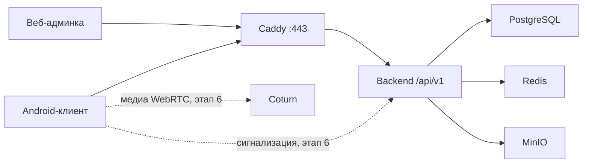

# Архитектура

Personal Messenger — закрытый мессенджер для сообщества до нескольких сотен пользователей. Это модульный монолит, а не набор микросервисов. Отдельный процесс предусмотрен только для TURN-реле. Групповые видеозвонки не строятся на mesh: для них позже выбирается SFU.

## Плоскости

- Control plane: Spring Boot. Авторизация, чаты, приглашения, сигнализация звонков, админ-API.
- Media plane: WebRTC напрямую между устройствами. Coturn — запасной TURN/STUN. Аудио и видео не проходят через backend.
- Storage plane: PostgreSQL для метаданных и непрозрачного тела сообщения, Redis для краткоживущего состояния, MinIO для файлов.

## Модули

| Модуль | Состояние после этапа 1 | Где живёт |
| --- | --- | --- |
| Identity, invitations, profiles, contacts | Схема есть, API нет | `users`, `devices`, `sessions`, `invitations` |
| Private chats, groups, messages | Схема и ограничение дедупликации есть, доставки нет | `conversations`, `messages` |
| Attachments | Загрузка через API, файл в MinIO, ссылка на 5 минут | `attachments`, MinIO |
| Realtime, presence, push | Не включены | WebSocket с этапа 3, FCM с этапа 4–6 |
| Voice messages, calls | Не включены | WebRTC с этапа 6 |
| Search, moderation, settings | Схема `blocks` и `app_settings` | API позже |
| Admin API, audit | Таблицы есть, панель показывает только health | этап 7 |
| Health | Работает | `GET /api/v1/health` |

Каталоги: `backend/`, `android/`, `admin-web/`, `deploy/`, `docs/`, `scripts/`.

## Сообщения и синхронизация

Сервер назначает `messages.seq` как глобальный возрастающий идентификатор. Клиент после офлайна запрашивает `seq` больше сохранённого курсора. Повторная отправка одного сообщения с тем же `sender_device_id` и `client_message_id` отклоняется уникальным ограничением. Это правило уже зафиксировано в миграции и проверено тестом. Сам обмен сообщениями — этап 3.

Поле `ciphertext` — непрозрачные байты. Значение `encryption = none` означает, что сервер может прочитать содержимое. Значение `signal_v1` зарезервировано для этапа 5. Пока E2EE нет, продукт это не обещает: health явно возвращает `e2ee: NOT_ENABLED`.

Личный чат двух пользователей уникален по `conversations.direct_key` — отсортированная пара идентификаторов.

## Идентификация

Пароли будут храниться как Argon2id. В схеме колонка называется `password_hash`; колонки `password` нет. Приглашение хранится как `code_hash`, открытый код показывается только в момент создания. Сессия хранит хеш refresh-токена, не сам токен. Реализация входа — этап 2.

Клиентский `user_id`, `role` и `chat_id` не являются источником прав. С этапа 2 личность берётся только из проверенной сессии.

## Клиенты

Android: Kotlin, Compose, Material 3, Hilt, OkHttp. `minSdk` 26. Сейчас есть один рабочий экран проверки `GET /api/v1/health`. Room, WebSocket и WebRTC добавляются вместе с соответствующими сценариями, а не пустыми кнопками.

Админка: React, TypeScript, Vite, MUI, TanStack Query. Экран показывает ответ health API. Счётчики пользователей не рисуются, пока для них нет API.

## Наблюдаемость

Лог доступа содержит метод, путь без query, статус и длительность. Тело запроса и заголовок Authorization не пишутся. `X-Correlation-Id` принимается только если состоит из безопасного набора символов, иначе генерируется заново. Actuator `/actuator/health` не показывает детали компонентов наружу. Подробный статус для диагностики — `GET /api/v1/health`; перед публикацией в интернет его нужно ограничить сетью или административной сессией.
